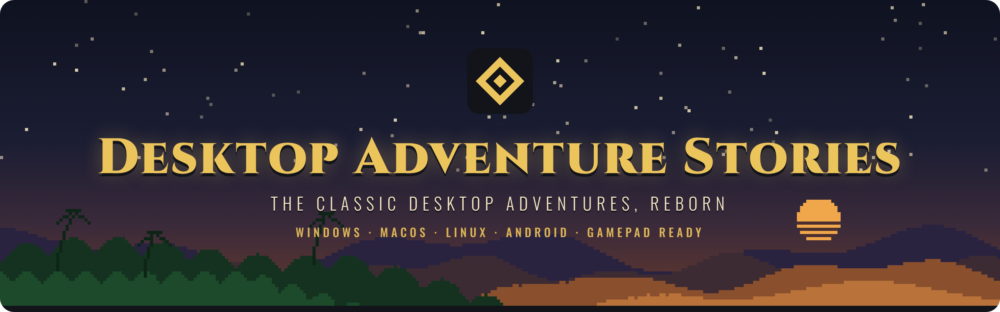

  

  <b>Play <i>Indiana Jones and His Desktop Adventures</i> and <i>Star Wars: Yoda Stories</i> 
  on today's computers, phones and tablets.</b>

  
  
  
  

  <a href="#download-and-play">Download</a> ·
  <a href="#add-your-games">Add your games</a> ·
  <a href="#controls">Controls</a> ·
  <a href="#mods-and-the-editor">Mods &amp; editor</a> ·
  <a href="#faq">FAQ</a> ·
  <a href="docs/building.md">Build from source</a>

---

**Desktop Adventure Stories** is a free, open-source, from-scratch remake of
the engine behind the 1996–1997 *Desktop Adventures* games. Bring your own
copy of the originals, and play them again with a modern interface, smooth
scaling to any screen, gamepad and touch controls, and an editor to make your
own adventures.

> [!NOTE]
> **Status: playable.** Both games can be played from start to finish in
> generated worlds, and the editor makes mods. It has not been tested much on
> real devices yet, so please press **F8** (or *Report a bug* in the pause
> menu) when something goes wrong, or go through the
> [device test list](docs/device-testing.md).

## Features

- 🗺️ **A new adventure every time.** Worlds are generated just like in the
  originals: the same seed gives the same world. Pick the world size and the
  difficulty.
- 🖥️ **Modern interface.** Your own game's pixel art, scaled sharply to any
  window, with a clean side panel for health, weapon and inventory (below the
  play field on tall screens). Menus and text use the easy-to-read Fira Sans
  font, sharp on every screen. No Windows 3.1 look.
- 🎮 **Play your way.** Keyboard, mouse, gamepad or touch. Every key and button
  can be changed.
- 💾 **Never lose your game.** It saves itself every few minutes and whenever
  you leave, and you can save in three slots of your own.
- 🐞 **Report bugs from the game.** F8, both gamepad sticks or the pause menu
  save a snapshot of the moment (your note, a screenshot and the game's state)
  and fill in a bug report for you.
- 📱 **Everywhere.** Windows, macOS, Linux and Android, from one codebase.
- 🛠️ **Editor and mods.** Change or add zones, tiles, characters, puzzles,
  scripts and sounds in a beginner-friendly editor, and share them as mods.
- 🔓 **Open.** GPL-licensed code, and open file formats for game data, mods
  and saves.

## Download and play

Get the package for your system from the
**[latest release](https://github.com/NilioDev/DesktopAdventureStories/releases/latest)**.
The first time you start it, it asks for your game files (see
[Add your games](#add-your-games)).

| System | Download | |
| --- | --- | --- |
| 🪟 **Windows** | `…-windows.zip` | Unpack, double-click `DesktopAdventureStories.exe` |
| 🍎 **macOS** | `…-macos.dmg` | Drag the app to *Applications* |
| 🐧 **Linux** | `…-linux-x86_64.AppImage` | One file, nothing to install |
| 🤖 **Android** | `…-android.apk` | Android 5 or newer |

<b>🪟 Windows: step by step</b>

1. Download `DesktopAdventureStories-<version>-windows.zip` and unpack it.
2. Double-click `DesktopAdventureStories.exe`.
3. Windows SmartScreen may warn the first time because the program is not
   signed: choose *More info*, then *Run anyway*.
4. Press *Choose game files*, or put your games in a `gamedata` folder next to
   the `.exe` before starting.

<b>🍎 macOS: step by step</b>

1. Download `DesktopAdventureStories-<version>-macos.dmg`, open it and drag the
   app to *Applications*.
2. The app is not signed, so the first time right-click it and choose *Open*,
   then *Open* again.
3. Press *Choose game files*, or drop your game folder on the window.

<b>🐧 Linux: step by step</b>

1. Download `DesktopAdventureStories-<version>-linux-x86_64.AppImage`. That one
   file is the whole program.
2. Right-click the file, open *Properties* and turn on *Allow executing file as
   program* (in some file managers: *Executable as Program*, or a
   *Permissions* tab).
3. Double-click it.
4. Press *Choose game files* and pick your game folder or a zip of it. Or put
   your games in a `gamedata` folder next to the AppImage before starting.

To get it in your application menu, use a tool such as
[Gear Lever](https://flathub.org/apps/it.mijorus.gearlever) or
[AppImageLauncher](https://github.com/TheAssassin/AppImageLauncher).
A plain `DesktopAdventureStories-<version>-linux.tar.gz` with the same program
is on the releases page too.

<b>🤖 Android: step by step</b>

1. Download `DesktopAdventureStories-<version>-android.apk` on your phone or
   tablet and open it.
2. The first time, Android asks to allow installing apps from this source (your
   browser or file manager).
3. Start the app and choose a `.zip` of your game folder, or its files.

Rather build it yourself? See **[Building from source](docs/building.md)**.

## Add your games

This project contains **no game data**. You need your own copy of the original
games; the program reads these files from it:

| Game | Data file | Executable (only for the colour palette) |
| --- | --- | --- |
| Indiana Jones and His Desktop Adventures | `DESKTOP.DAW` | `DESKADV.EXE` |
| Star Wars: Yoda Stories | `YODESK.DTA` | `YODESK.EXE` |

The easiest way is to give the program the **whole game folder** from your CD
or installation, or a `.zip` of it. You can:

- press *Choose the game folder* on the welcome screen at first start (on
  Android: *Choose the zip*), or *Add games* in the title menu later,
- drop the folder or zip on the window,
- put the games in a `gamedata/yoda/` and `gamedata/indy/` folder next to the
  program (see [gamedata/README.md](gamedata/README.md)),
- or pass the folder or zip on the command line.

The first time, each game is imported into our own open format in the app's
library. After that the original files are no longer needed. Your very
first game starts with a short *How to play* card for your keyboard, gamepad
or touch screen; it is in the pause menu too.

| System | Library folder |
| --- | --- |
| Windows | `%APPDATA%\DesktopAdventureStories\library` |
| Linux | `~/.local/share/DesktopAdventureStories/library` |
| macOS | `~/Library/Application Support/DesktopAdventureStories/library` |

## Controls

| Action | Keyboard | Gamepad | Mouse / touch |
| --- | --- | --- | --- |
| Move | Arrow keys / WASD | D-pad / left stick | Click or tap where to go |
| Use the selected item, talk | Space / Enter | A (south) | Click the selected item again |
| Attack | Ctrl / X | B (east) | |
| Previous / next item | Q / E | LB / RB | Click an item |
| Map | M / Tab | Back / Select | Map button |
| Menu, back | Esc | Start (B goes back in menus) | Menu button |
| Report a bug | F8 | Both sticks pressed in (L3 + R3) | Menu → Report a bug |

Every key and button can be changed under *Options → Controls*.

The title screen starts a new game in a generated world, continues your
newest save, loads another one, or opens the options. In the game, *Save
game* in the pause menu (Escape, or Start on a gamepad) keeps your game in
one of three slots. On desktop, the *data viewer* in the title menu
shows every zone and tile of a game. More about the screen layout in
[docs/interface.md](docs/interface.md).

## Mods and the editor

Mods change or extend a game: new or changed zones, tiles, sounds and title
screens. A mod is a folder (or a `.zip` of it) in the `mods` folder next to the
library; switch it on under *Mods* in the title menu.

The *Editor* in the title menu lets you make your own: draw zones and tiles,
write scripts as simple sentence cards, and set up characters, puzzles and
sounds. Your changes are saved as a mod.

- [Using the editor](docs/editor.md)
- [The mod format](docs/formats/mod.md)

## FAQ

<b>Where do I get the games?</b>

From your own copy of the originals: an old CD or an existing installation.
This project does not include, download or sell them.

<b>Do I need to keep the original files?</b>

No. They are imported once into the app's library (see the table above). To
import them again, start the program with `--reimport`.

<b>Windows or macOS says the program can't be trusted.</b>

The packages are not signed yet. On Windows choose *More info → Run anyway*;
on macOS right-click the app and choose *Open*. See
[Download and play](#download-and-play).

<b>Something doesn't work.</b>

Press **F8** (both sticks on a gamepad, or *Report a bug* in the pause menu)
right when it happens. Pick what kind of problem it is, add a note and choose
*Report on GitHub*: the game saves a snapshot of the moment, opens a bug
report in your browser with your note, the game's state, the version, your
system and the end of the log filled in, and opens the folder with the
snapshot so you can drag it onto the report. Snapshots stay on your device
until you add one yourself. More in [docs/bug-snapshots.md](docs/bug-snapshots.md).

Without a browser, please
[open an issue](https://github.com/NilioDev/DesktopAdventureStories/issues/new?template=bug_report.yml)
and add the snapshot, or `log.txt` from the app's folder (next to the
`library` folder in the table above). Want to help test on your own
computer, phone or tablet? See
the [device test list](docs/device-testing.md).

## For developers

| | |
| --- | --- |
| [Building from source](docs/building.md) | Build on each system, command line options, tests |
| [CONTRIBUTING.md](CONTRIBUTING.md) | How to help, and the clean-room rules |
| [docs/formats/](docs/formats/README.md) | The original file formats and our own open formats |
| [docs/world-generator.md](docs/world-generator.md) | How worlds are generated |
| [docs/combat.md](docs/combat.md) · [docs/savegames.md](docs/savegames.md) · [docs/music.md](docs/music.md) | Game systems |
| [docs/releases.md](docs/releases.md) | How the release packages are made |

## Ground rules and legal

- **No game data.** The original game world (tiles, sprites, sounds) is loaded
  from the player's own files. Never commit those files, or anything extracted
  from them, to this repository.
- **Clean room.** All code here is written from scratch for this project. Code
  from other engine reimplementations is not copied or adapted; other projects
  may only be used as documentation of the file format.
- **Own look.** The interface around the game world is our own and modern, not
  a copy of the Windows 3.x interface.
- **Trademarks.** This project is not affiliated with or endorsed by Lucasfilm,
  Disney or LucasArts. Game names are used only to describe compatibility.

## License

GPL-3.0-or-later. See [LICENSE](LICENSE).

The interface font is [Fira Sans](https://github.com/mozilla/Fira) by the
Mozilla Foundation and Telefonica S.A., under the SIL Open Font License 1.1
(see [assets/fonts/OFL.txt](assets/fonts/OFL.txt)). It is built into the
program and its license comes with every package.
